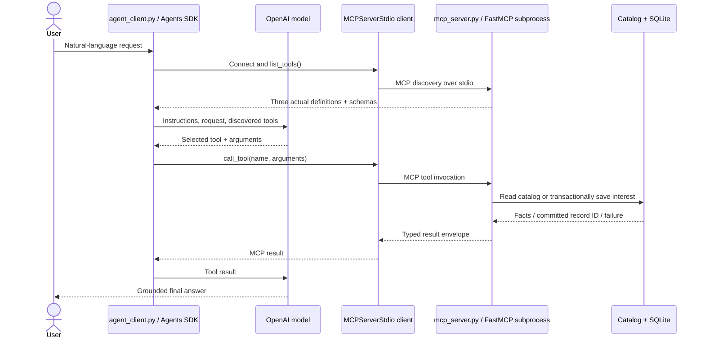

# Architecture

The host is this Python application plus the Agents SDK runtime. `MCPServerStdio` is the SDK's server-connection abstraction containing the actual MCP client; its name does not mean the FastMCP server runs in the host process. It starts `mcp_server.py` using `sys.executable` and an absolute path, with the project as working directory. `async with` owns connection startup and cleanup, including exceptions. No local `function_tool` is supplied to the agent; it receives only `mcp_servers=[server]`.

The server has exactly three decorated functions. They delegate to ordinary functions in `business.py`. The orchestration function calls the same lookup and persistence functions used by the other two tools. These are real internal Python calls, **not two nested MCP round trips**. The agent's invocation of the orchestrator is one real MCP call. Its `steps` are populated after those functions return, and its result exposes their actual outcome codes. This is the sharing of underlying business functions permitted by the task.

Stdio avoids hosting, ports and extra credentials. Server stdout contains only protocol traffic; business events go to stderr with server PID, capability, outcome and record ID. The client's observer awaits `super().call_tool(...)` before printing received results. Thus its arrows label actual boundary events, although they are not a raw packet capture. Saved SQLite rows provide independent proof of side effects. No extra MCP tools or resources are required.

## State and safety

The JSON catalog is local, fictional and read-only. The Data capability does not even open the store. The Action capability accepts explicit intent, validates contact fields and a published service, then commits a parameterized SQLite insert. A uniqueness constraint on normalized email and canonical service prevents duplicate records across tools, restarts and concurrent server processes. Repeats preserve the original name/notes; they return its ID and `created=false`. This rule intentionally supports one outstanding interest per email/service, not recurring appointments. Deleting or updating interests is an operator task outside these three tools.

Both write interfaces require a strict Boolean consent field; the host instructions require a real user request before setting it. This is an application policy plus server input gate, not cryptographic evidence of consent. A malicious client could assert consent. The local prototype has no authentication or identity proof and is not a public production service. Free-text notes are never interpreted as commands by server code. No arbitrary filesystem path, SQL, URL or network operation is exposed as a tool argument.

Only the host loads `.env`. The child receives configuration through an explicit allowlist and the SDK's basic OS environment defaults, without the OpenAI key. Cloud tracing is disabled; the OpenAI model still receives the conversation and tool arguments necessary for the request. Logs/results omit customer name/email/notes; the local SQLite store retains them. Use only fictional example.com contacts for demonstration. An operator must control access and delete runtime data when no longer needed; automatic retention is future work.

Domain errors use a stable JSON status/code/message. Invalid schema inputs use MCP `is_error` errors. These two layers must both be checked; `is_error=false` alone does not guarantee a successful business outcome. Unexpected FastMCP errors are masked. No API, storage or exception body is printed by the CLI error handler.
