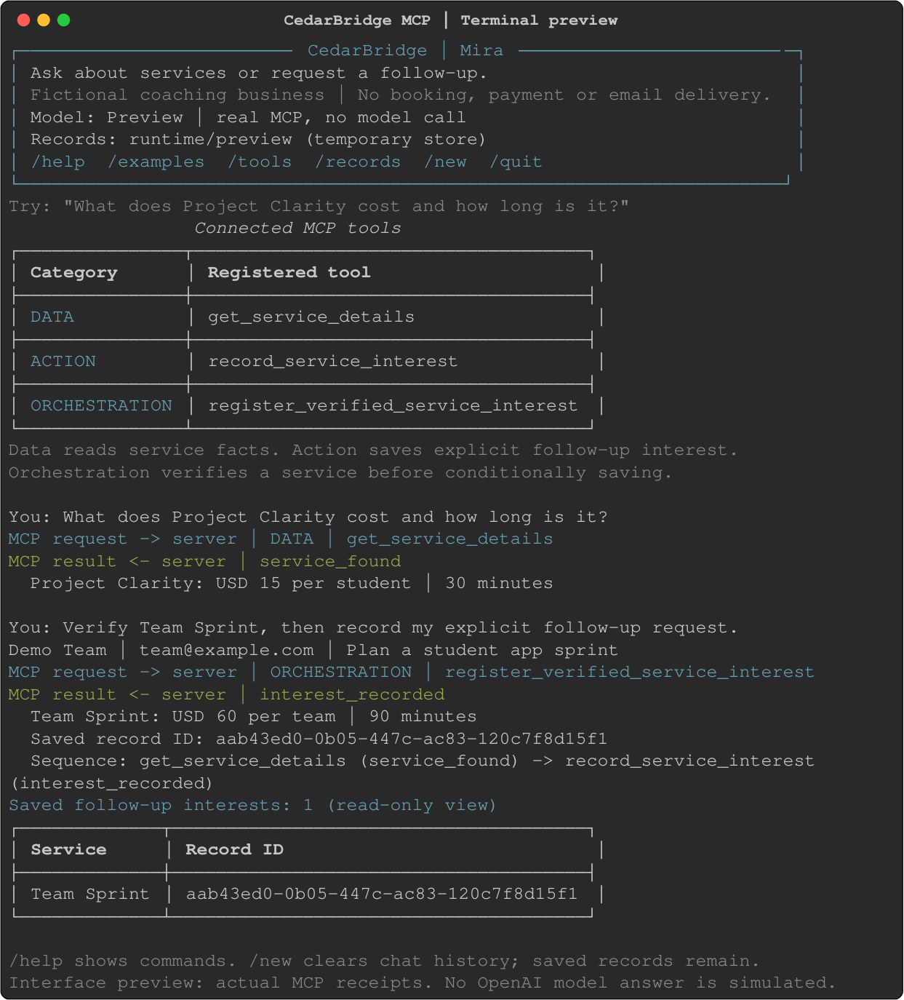
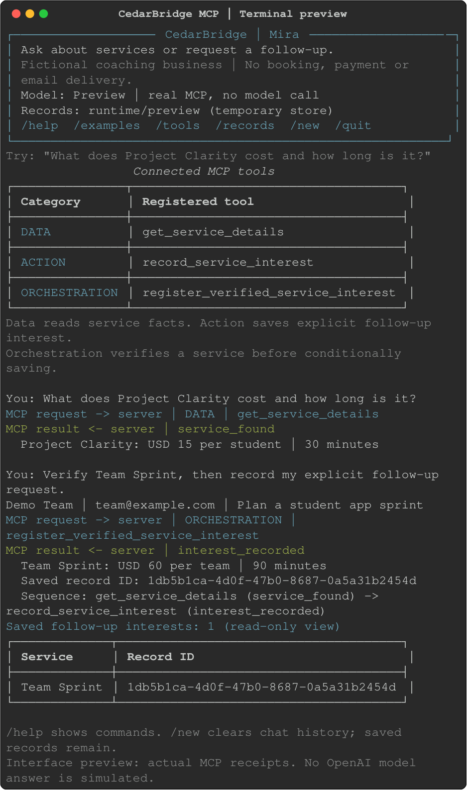

# Interface and usability review — 2026-10-31

> Historical review snapshot. See [Submission handoff](submission.md) for current deliverables and remaining steps.

C5's user interface is intentionally a command-line chat and demonstration interface. It supports the assignment's real-time agent/tool screencast without adding a web frontend or more tools.

## Reviewed flows

- **First launch:** identifies Mira, explains the fictional business boundary, shows model and record directory, lists slash commands and offers an example request.
- **Missing key:** gives exact local configuration guidance and key-free alternatives. Credentials and provider request bodies never appear in errors.
- **Discovery:** `--list-tools` is a short category/name table sourced from the running server; `--schemas` emits full JSON for inspection or redirection.
- **Chat:** a compact real MCP request/result receipt precedes the model's separately labeled answer. Committed record IDs are always visible in the receipt. Optional `--trace` includes raw result JSON and server capability events.
- **Recovery:** one failed request does not end interactive chat. Failed conversation history is not appended. Existing tool receipts remain valid, and `/records` helps inspect possible completed side effects before retrying.
- **Navigation:** help, examples and tools are discoverable; `/new` explicitly clears only conversation history; `/records` is a read-only operator view; quit/exit/EOF clean up the connection.
- **Recording:** seven labeled steps, Enter to continue, `q` or EOF to stop, real persistence proof and atomic evidence snapshots. Cancellation cannot be reported as a completed pass.
- **Narrow windows:** actual tool names, receipts, UUIDs and orchestration sequences wrap within 60- and 80-column terminal layouts. Use at least 80 columns and a readable font for the screencast.

The automated CLI tests cover missing credentials, empty one-shot rejection, machine-readable discovery, commands, recovery, safe messages, configuration consistency and receipt privacy/wrapping. The fresh real multi-turn check is `evidence/history/interactive_cli.json`: scripted user input drives the actual CLI, OpenAI model and MCP server; model responses are not mocked. It correctly looked up a service, recorded one requested follow-up, displayed its actual ID and retained it after `/new`. The initial probe expected the standalone Action tool, but the model used Orchestration for the context-dependent request. The report retains that routing-specific failure alongside explicit manual review. The separate seven-case demo still requires and successfully exercises both dedicated tool categories.

## Visual exports

These are terminal-layout exports from **actual credential-free MCP calls**, not screenshots of a running desktop, not a model-answer simulation and not the required video. Rich generated the terminal content; local rendering used inline styles and a built-in monospace font. No browser or remote-font access was needed for the final images.





Reproduce the HTML/SVG exports with:

```powershell
.venv\Scripts\python.exe -m scripts.preview_interface --width 80
.venv\Scripts\python.exe -m scripts.preview_interface --width 60
```

Outputs go to ignored `runtime/ui-preview`. The core application needs no image renderer. The separately reviewed PNGs above are bundled for convenience.

## Scope of conclusion

Both the primary agent and reviewer checked the CLI flows; the reviewer found no remaining usability blocker for this assignment. This was an engineering review, not a controlled study with novice users. Model prose can vary; the actual MCP receipt remains the reliable displayed result. The original 5–7-minute recording and publication requirements still apply.
